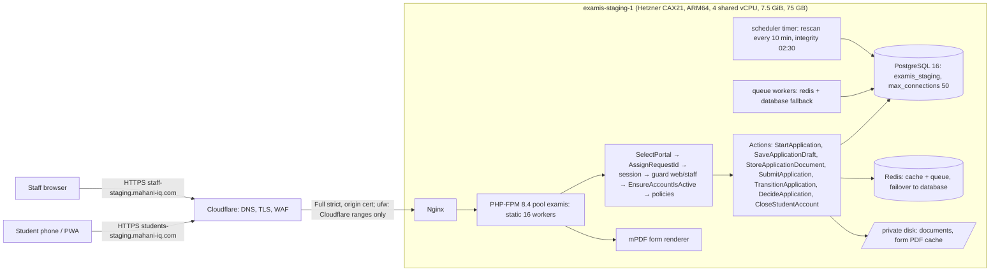

# Current system architecture (`0f0de40`)

Read from the code and the staging deployment files. Server facts are from the deployment log of 2026-11-04 and are **UNKNOWN today** until gate G1.

## Components

| Component | Facts | Status |
| --- | --- | --- |
| Laravel 13.17+, PHP 8.4, Fortify (staff only), Inertia v3, React 19, TypeScript, Tailwind 4, Vite 8 | `composer.json`, `package.json` | VERIFIED |
| Two portals on two hosts, guards `web` (students) and `staff`; host-only cookies; staff sessions in `staff_sessions` | `routes/*.php`, ADR-0011 | VERIFIED |
| Sessions in PostgreSQL (`SESSION_DRIVER=database`): one row write per request | `env.staging.example` | VERIFIED (file) |
| Cache and queue: Redis with database failover; queues `documents`, `default` | same | VERIFIED (file) |
| Document scan inline during upload (`DOCUMENT_SCAN_INLINE=true`), structural scanner only, no antivirus | `config/examis.php` | VERIFIED; antivirus MISSING (B3) |
| Form PDF generated during submission (`ReceiptRenderer::warm`) and cached on the private disk | `ApplicationSubmissionController@store` | VERIFIED |
| Notifications: database channel, queued after commit; students cannot open the notifications page | `ApplicationStatusChanged`, `KeepStudentsOnTheirPath` | VERIFIED |
| Decision messages to students: sent by hand through WhatsApp | ADR-0013 | VERIFIED (ADR) |
| Mail: `log` driver; no SMS | env files | VERIFIED (file) |
| PostgreSQL roles: `examis_owner` (migrations), `examis_app` (runtime, `lock_timeout 5s`, `statement_timeout 30s`) | `provision.sh` | VERIFIED (file) |
| Inertia DevTools routes registered (`_inertia/devtools/*`) | `route:list` on the workstation | EXISTS BUT NOT VERIFIED whether reachable on staging |

## Likely bottlenecks (hypotheses, not findings)

| Point | Why it may matter | How it will be measured |
| --- | --- | --- |
| Submission renders the PDF in the request | mPDF 40–60 MB and CPU per form inside `POST /submit` | `http_req_duration{name:POST /applications/:uuid/submit}` vs. `GET receipt` |
| 16 static PHP-FPM workers | request 17 waits in the listen queue | FPM `listen queue`, `max children reached` |
| One session row write per request | write load on PostgreSQL | `pg_stat_statements` on the `sessions` update |
| Inline photo scan and re-encode | CPU inside the upload request | `type:upload` p95 |
| Period counter row (`exam_periods … FOR UPDATE`) | serializes concurrent submissions | lock waits during `submission-flow.js` |
| Per-address rate limits | all k6 traffic comes from 127.0.0.1 | 429 count (see `06-test-safety-guards.md` for the header plan) |
| App, database, Redis and k6 share 4 vCPU | generator competes with the application | k6 CPU vs. its quota; CPU steal |
