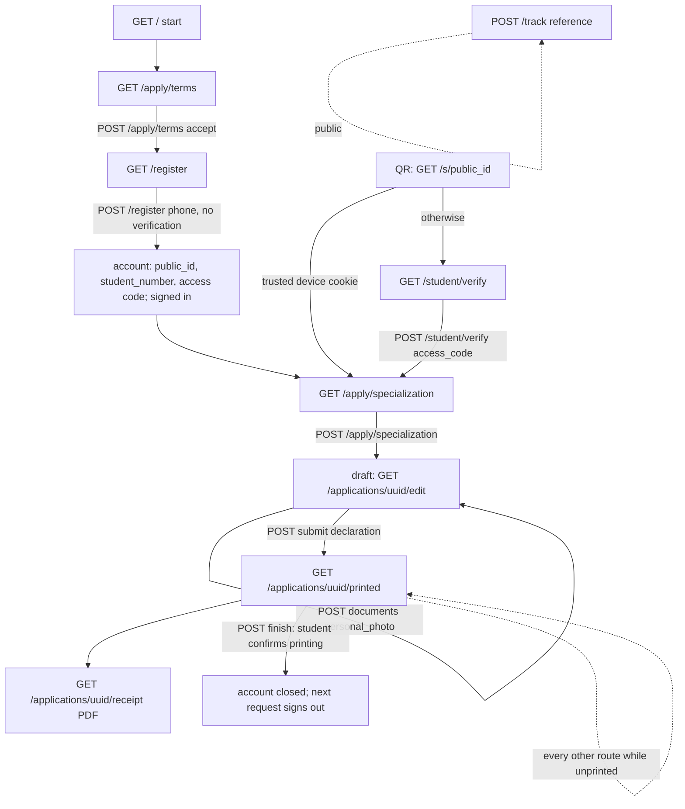

# Student and staff flows (`0f0de40`)

Read from the code, route by route (`php artisan route:list` on the workstation, controllers, actions, requests, policies). The journey through steps 1–14 and the staff steps marked ★ also ran as an automated test with the same accounts and answers k6 uses: `tests/Feature/QualityEngineering/LoadJourneyContractTest.php`, 34/34 PASS (`evidence/pest-quality-engineering.txt`). Steps without ★ on the staff side are read from code only (EXISTS BUT NOT VERIFIED in this phase; existing Pest tests cover them).

Every request also passes `SelectPortal` (host decides the portal, other hosts 404), `AssignRequestId` (`X-Request-Id`), the session (PostgreSQL `sessions` / `staff_sessions` row), CSRF on writes, `SetLocale`, `EnsureAccountIsActive` and `SecurityHeaders`.

## Student



| # | Step | Route | Controller / action | Middleware, guard, policy | Validation | Tables written | Expected response |
| --- | --- | --- | --- | --- | --- | --- | --- |
| 1 | Open portal | `GET /` | `Public\StartController` | none | — | `sessions` | Inertia `start` |
| 2 | Start: terms | `GET /apply/terms`, `POST /apply/terms` | `ApplicationTermsController@show/accept` | `guest:web` | `accept` accepted | `sessions` (terms time) | `apply/terms`; POST → `/register` |
| 3 | Phone | `GET /register`, `POST /register` | `StudentRegistrationController@store` → `CreateNewUser` | `guest:web`, `throttle:registration` (3/min, 30/day per address) | terms in session; phone `^\+?[0-9]{10,15}$` after digit normalisation. **No verification** of the number (ADR-0009) | `users`, `audit_events` (`student.registered`), `sessions` | → `/apply/specialization` |
| 4 | Account | (same request) | `StudentIdentity::ensureIdentity`, `issueAccessCode` | — | — | `users.public_id` (uuid), `student_number` (random 100000–999999, retried on clash), `access_code` (plain text, owner's decision) | code shown once (session) |
| 4b | "Retrieve" an account | none | — | — | — | — | One-time accounts (ADR-0010): a returning student registers again and gets a new number |
| 5–6 | Sign in again | `GET /s/{public_id}` → `GET /student/verify` → `POST /student/verify` (also `POST /student/login` by student number; the form was removed, the route stays) | `StudentLoginController@qr/code/verify` | `guest:web`; `throttle:student-login` (10/min per address + hourly), `throttle:student-code` (5/min per session and address); 10 failures/hour per account lock | `access_code` required ≤ 20; trust_device boolean | `trusted_devices` (if trusted), `audit_events` (`auth.failed`, `auth.lockout`, `student.device_trusted`), `sessions` | trusted device → signed in directly; else code page; then the dashboard redirect |
| — | Dashboard | `GET /dashboard` | `Applicant\DashboardController` | `auth:web` | — | — | **redirect only**: no application → specialization; draft or waiting on student → edit; otherwise → printed |
| 7 | Specialization | `GET/POST /apply/specialization` | `SpecializationController` → `StartApplication`, `SaveApplicationDraft` | `auth:web`, `throttle:application-writes` (60/min per user); Gate `create` (applicant, active) | branch and category in the open period's eligible lists | `applications` (unique user+period), `application_events` (`created`), `audit_events` | → `/applications/{uuid}/edit` |
| 8–9 | Form steps 1–3 | `PUT /applications/{uuid}` with `step` | `ApplicationController@update` → `SaveApplicationDraft` | `auth:web`, throttle; `SaveApplicationRequest` → policy `update` (owner, else 404; editable) | per field; fields of the step required; Arabic-only name parts; phone forced from the account; `lock_version` | `applications` under `FOR UPDATE`; `lock_version + 1` **only when a value changed**; stale version → error, nothing saved | → `edit?step=n+1`; steps: 1 personal, 2 address, 3 school, 4 documents, 5 review |
| 10 | Photo | `POST /applications/{uuid}/documents` | `ApplicationDocumentController@store` → `StoreApplicationDocument` | `auth:web`, `throttle:uploads` (20/min per user); policy `update` | type required by the period (only `personal_photo` in the demo period), ≤ 2048 KB, jpg/png, MIME sniffed | private disk (random key, JPEG re-encoded), `application_documents` (previous one `replaced_at`), `application_events` | back to the edit page with the photo `verified` |
| — | Camera photo refusal | browser only (`photo-taken-at.ts`, EXIF time < 15 min) | — | — | **not enforced by the server** | — | — |
| 11 | Document check | inline scan (`DOCUMENT_SCAN_INLINE=true`), otherwise job `ScanApplicationDocument` on queue `documents` | `StructuralDocumentScanner` | — | signature, active PDF content, image decode, pixel budget; **not antivirus** | `application_documents.status` | `verified` or `rejected` (file deleted) |
| 12–13 | Submit and reference | `POST /applications/{uuid}/submit` | `ApplicationSubmissionController@store` → `SubmitApplication`, then `ReceiptRenderer::warm` | `auth:web`, throttle; policy `submit` (owner) | `declaration` accepted; fields + required documents complete; eligibility re-checked | under one transaction (3 deadlock retries): `applications FOR UPDATE`, `exam_periods FOR UPDATE` (`last_sequence + 1`), random reference, `application_events` (`status_changed`), `audit_events`; notification queued after commit; form PDF rendered and cached in the same request | → `/applications/{uuid}/printed`; a repeat returns the same application unchanged |
| 14 | PDF | `GET /applications/{uuid}/receipt` | `ApplicationReceiptController` → `ReceiptRenderer::cached` | `auth:web`; policy `downloadReceipt` | reference exists | `audit_events` (`receipt.downloaded`), PDF cache | `application/pdf` |
| 14b | Printed page, close | `GET …/printed`, `POST …/finish` | `ApplicationSubmissionController@printed/finish` → `CloseStudentAccount` | `EnsureAccountIsActive` sends every other route here until printing is confirmed | — | `users.closed_at`, code removed, devices revoked, audit | after finish the account is closed for good |
| 15 | Tracking | `GET/POST /track`; QR verification `GET /verify/{token}` | `TrackApplicationController`, `ReceiptVerificationController` | `throttle:public-lookup` (10/min, 100/h per address) | reference only (ADR-0010) | — | status of an account not yet closed |
| 16 | Status and notifications | stored in `notifications`; page `GET /notifications` redirects students away | `KeepStudentsOnTheirPath` | — | — | — | students see their status on the printed page and through tracking; decisions are sent by WhatsApp by hand |

## Staff

```mermaid
flowchart TD
  L[GET /staff/login] -->|POST /login email + password, no 2FA| H[/admin/home]
  H --> I[GET /admin/applications status, period, assigned, q]
  I -->|exact match on q| S
  I --> S[GET /admin/applications/uuid: audited view]
  S --> DOC[GET /admin/documents/uuid: verified only, audited]
  S -->|POST transition under_review: self-assigns| S
  S -->|POST transition requires_correction / accepted / rejected + reason| S
  S -->|POST decision accepted / rejected / requires_correction| S
  S -->|POST assign| S
  H --> RP[GET /admin/reports, CSV export, student Excel export]
```

| Step | Route | Code | Guard, permission | Tables | Expected |
| --- | --- | --- | --- | --- | --- |
| ★ Sign in | `GET /staff/login`, `POST /login` | `StaffLoginController`, Fortify (`authenticateUsing`: staff, active) | `guest:staff`, `throttle:login` (5/min per email+address, hourly per address); `DropRememberMe`; idle 30 min | `staff_sessions`, `audit_events` | → `/admin/home` (`admin/home`) |
| ★ List and filter | `GET /admin/applications?status&period&assigned&q&per_page` | `Admin\ApplicationController@index` | `auth:staff`, `can:admin.access`, Gate `viewAny` (`applications.view`); `visibleToStaff` scope | — | `admin/applications/index` |
| Search | same, `q` | reference, ID, name prefix, student number; an exact match redirects to the application | same | — | index or show |
| ★ Open | `GET /admin/applications/{uuid}` | `@show` | policy `view` (`isVisibleToStaff`, else 404) | `audit_events` (`application.viewed`) | `admin/applications/show` with allowed transitions |
| Documents | `GET /admin/documents/{uuid}` | `ApplicationDocumentController@show` | `documents.view`; only `verified` files | `audit_events` (`document.viewed`) | file stream, `nosniff`, sandbox CSP |
| ★ Start review | `POST …/transition` `target=under_review` | `TransitionApplication` | policy `transition` (`applications.review`) | `applications` `FOR UPDATE`, `assigned_to` = actor, events, audit, notification | show page, status `under_review` |
| Return / accept / reject | `POST …/transition` or `POST …/decision` | `TransitionApplication`, `DecideApplication` (walks through `under_review` when needed) | `applications.review` for corrections, `applications.decide` for accept/reject, `applications.reopen` to reopen; reason required for correction, rejection, reopening; acting on another's assignment needs `applications.view_all` | same | show page / back |
| Assign | `POST …/assign` | `AssignApplication` | `applications.assign` | `applications`, events | — |
| Audit | every action above | `AuditLogger`, `application_events` | append-only (PostgreSQL triggers) | `audit_events`, `application_events` | — |
| Reports | `GET /admin/reports`, `…/{period}/export`, `/admin/student-export(/download)` | `ReportController`, `StudentExportController` | `reports.view`; Excel needs `applications.view_all` | `audit_events` (export) | page, CSV, XLSX |
| ★ Reviewer limits | `GET /admin/users` as reviewer | — | `can:users.manage` | — | 403 |

Status machine (`ApplicationStatus`): draft → submitted | withdrawn; submitted → under_review | withdrawn; under_review → requires_correction | accepted | rejected; requires_correction → resubmitted | withdrawn; resubmitted → under_review; accepted / rejected → under_review (reopen).

Roles: administrator (all), supervisor (view all, review, decide, assign, reopen, documents, reports), reviewer (view, review, documents), auditor (view all, reports).
