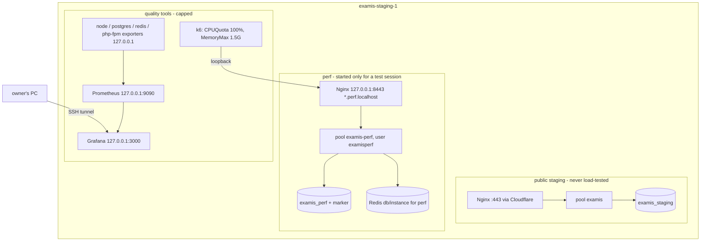

# Single-server architecture

## The server (measured at gate G1, 2026-11-06 21:49 +0300, read-only; evidence `evidence/g1-server-inspection.txt`)

| Resource | Value | Status |
| --- | --- | --- |
| Machine | Hetzner CAX21, `examis-staging-1`, Falkenstein; up 2 days | VERIFIED (G1) |
| CPU | 4 vCPU ARM64 Neoverse-N1, **shared**; idle at inspection (100% idle, steal 0) | VERIFIED (G1) |
| RAM / swap | 7,729 MB total, 754 MB used, 6,975 MB available; 2 GB swap file, 0 used | VERIFIED (G1) |
| Disk | 75 GB, 5.2 GB used, 67 GB free | VERIFIED (G1) |
| OS | Ubuntu 24.04.5 LTS aarch64, cgroup v2 (systemd CPU/memory caps available) | VERIFIED (G1) |
| Application | `/srv/examis/current` → `releases/20261106142707` (= `0f0de40`); 5 releases, 845 MB | VERIFIED (G1) |
| PHP-FPM | static pool `examis`, 16 workers (17 processes, 971 MB RSS), `memory_limit` 256M, OPcache 192 MB | VERIFIED (G1) |
| PostgreSQL 16.15 | `max_connections 50` (17 in use by `examis_staging`), `shared_buffers` 1.25 GB, `work_mem` 8 MB, slow log 250 ms; 23 processes, 650 MB RSS | VERIFIED (G1) |
| Databases | `examis_staging` (11 MB), `postgres`. **No `sis` database on this server.** | VERIFIED (G1, names and sizes only) |
| `pg_stat_statements` | available, **not** in `shared_preload_libraries` (enabling needs a restart → approval) | VERIFIED (G1) |
| Redis 7.0.15 | bound to loopback, 13 MB RSS | VERIFIED (G1) |
| Services | nginx, php8.4-fpm, postgresql, redis, examis-queue (+ fallback), scheduler timer, fail2ban, ufw: active | VERIFIED (G1) |
| Installed QE tools | none (no k6, Docker, Prometheus, exporters, Grafana, Semgrep, ZAP, Java); `python3` present | VERIFIED (G1) |
| Traffic | 250 lines in today's Nginx access log | VERIFIED (G1) |
| One earlier measurement | 50 VUs on public pages through Cloudflare, 4 min: 4,304 requests, 0% failed, p95 read 613 ms, load 0.24, 735 MB used | VERIFIED (log, 2026-11-04) |

Consequences for G2:
- **Connections.** A perf FPM pool plus a perf queue worker must fit in the 33 free PostgreSQL connections. Cap the pool at 16 workers, which leaves a margin, so `max_connections` and a restart can wait.
- **Memory.** About 6.9 GB is available. The perf stack (about 1 GB for 16 workers) plus k6 (capped at 1.5 GB) plus monitoring (about 0.5 GB) leaves more than 3.5 GB of headroom.
- **Caps.** cgroup v2 is present, so `systemd-run` with `CPUQuota` and `MemoryMax` caps work for every tool.

## Layout on one host

Database choice (decision D5): `examis_perf` inside the existing PostgreSQL cluster (no restart, shares `max_connections 50` and buffers) or a second cluster on another port (stronger isolation, its own `pg_stat_statements` without restarting the staging cluster, about 0.7–0.9 GB more RAM). Recommended: second cluster, if gate G1 shows the memory.

## Can everything run here without endangering the application?

Yes, with conditions; no, without them:

1. Load only in the perf vhost, never through the public portals.
2. Ceilings on every tool; one heavy tool at a time (k6 **or** ZAP **or** Playwright).
3. Stop when the server or the generator saturates (`13-defect-remediation.md`).
4. Results are "application + generator + monitoring on one shared 4 vCPU host". They are never reported as the application's capacity alone.
5. Since the project has no real users yet, the public staging portal may slow down during a session; sessions are announced in `17-execution-log.md`.

## Initial safe load (estimate, NOT measured)

| VUs | Expected req/s (10–20 s think time) | Expectation |
| --- | --- | --- |
| 1–5 | < 1 | safe |
| 10–20 | 1–4 | safe |
| 50 | 3–10 | likely fine (public pages reached 50 VUs at load 0.24) |
| 100 | 5–20, peaks higher on PDF and upload | target; plausible, to be proven |
| 150–200 | 10–40 | possible; k6 itself then needs about 1 vCPU |
| > 200 | — | refused by the guard: on this host the generator would distort the result |

First safe trial after the environment exists: `smoke.js` (1 VU), then `submission-flow.js` at 5 VUs.
