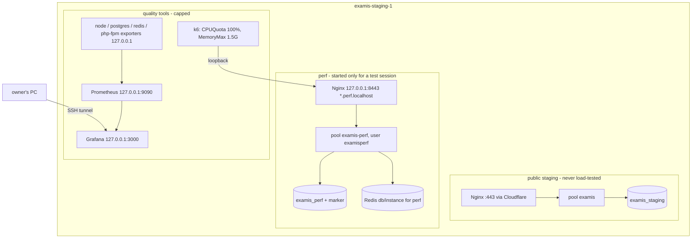

# Single-server architecture

## The server (from the deployment log, 2026-11-04; current values UNKNOWN until gate G1)

| Resource | Value | Status |
| --- | --- | --- |
| Machine | Hetzner CAX21, `examis-staging-1`, Falkenstein | VERIFIED (log) |
| CPU | 4 vCPU ARM64, **shared** (other tenants: CPU steal) | VERIFIED (log) |
| RAM / swap | 7.5 GiB / 2 GB swap file from `provision.sh` | VERIFIED (log, file) |
| Disk | 75 GB | VERIFIED (log); free space UNKNOWN |
| OS | Ubuntu 24.04.4 LTS aarch64 | VERIFIED (log) |
| PHP-FPM | static pool, 16 workers, 256 MB limit, OPcache 192 MB | VERIFIED (file) |
| PostgreSQL 16 | `max_connections 50`, `shared_buffers 1GB`, slow log 250 ms, `log_lock_waits on` | VERIFIED (file) |
| Redis | 256 MB, password, local | VERIFIED (file) |
| Installed QE tools | none known | UNKNOWN |
| One measurement | 50 VUs on public pages through Cloudflare, 4 min: 4,304 requests, 0% failed, p95 read 613 ms, load 0.24, 735 MB used | VERIFIED (log, 2026-11-04) |

## Layout on one host

Database choice (decision D5): `examis_perf` inside the existing PostgreSQL cluster (no restart, shares `max_connections 50` and buffers) or a second cluster on another port (stronger isolation, its own `pg_stat_statements` without restarting the staging cluster, about 0.7–0.9 GB more RAM). Recommended: second cluster, if gate G1 shows the memory.

## Can everything run here without endangering the application?

Yes, with conditions; no, without them:

1. Load only in the perf vhost, never through the public portals.
2. Ceilings on every tool; one heavy tool at a time (k6 **or** ZAP **or** Playwright).
3. Stop when the server or the generator saturates (`13-defect-remediation.md`).
4. Results are "application + generator + monitoring on one shared 4 vCPU host". They are never reported as the application's capacity alone.
5. Since the project has no real users yet, the public staging portal may slow down during a session; sessions are announced in `17-execution-log.md`.

## Initial safe load (estimate, NOT measured)

| VUs | Expected req/s (10–20 s think time) | Expectation |
| --- | --- | --- |
| 1–5 | < 1 | safe |
| 10–20 | 1–4 | safe |
| 50 | 3–10 | likely fine (public pages reached 50 VUs at load 0.24) |
| 100 | 5–20, peaks higher on PDF and upload | target; plausible, to be proven |
| 150–200 | 10–40 | possible; k6 itself then needs about 1 vCPU |
| > 200 | — | refused by the guard: on this host the generator would distort the result |

First safe trial after the environment exists: `smoke.js` (1 VU), then `submission-flow.js` at 5 VUs.
